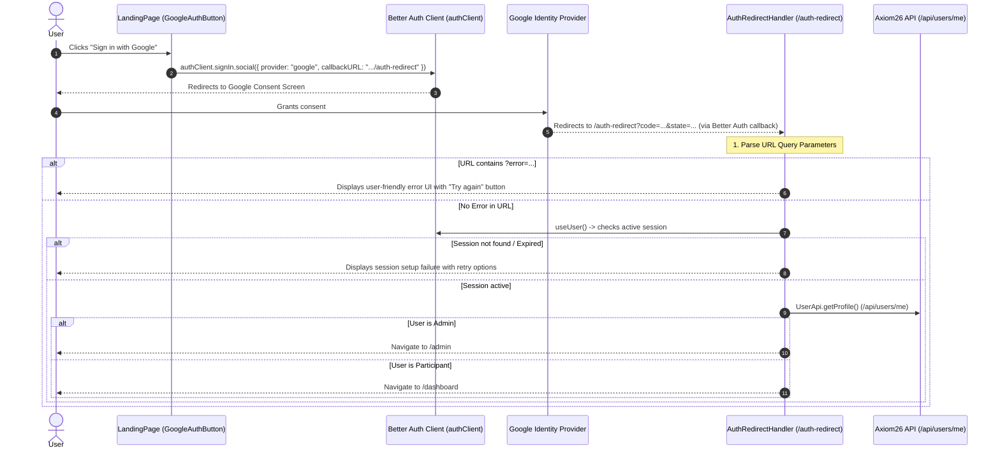

# Frontend Authentication Flow: AxiomFrontend

This document describes the authentication flow in `AxiomFrontend`, including component boundaries, hook lifecycles, and error states.

---

## 1. Component & Route Architecture

```
Routes (src/App.jsx)
 ├── "/"                        -> LandingPage.jsx (GoogleAuthButton)
 ├── "/auth-redirect"           -> AuthRedirectHandler.jsx (Post-login router & error handler)
 ├── "/dashboard" (Protected)   -> DashboardLayout.jsx (Protected by ProfileCompletionGuard / Auth)
 └── "/admin" (Protected)       -> AdminLayout.jsx (Protected by AdminGuard)
```

---

## 2. Authentication Flow Lifecycle



---

## 3. Initiation: `GoogleAuthButton` (`src/auth/client.jsx`)

1. **Feature Gating**:
   ```jsx
   export const googleAuthEnabled = import.meta.env.VITE_GOOGLE_AUTH_ENABLED === "true";
   ```
   If `googleAuthEnabled` is false, renders: *"Sign-in is unavailable right now. Please try again later or ask an organiser for help."*
2. **Initiation Call**:
   ```jsx
   const result = await authClient.signIn.social({
     provider: "google",
     callbackURL: new URL("/auth-redirect", window.location.origin).toString(),
   });
   ```
   If the network fails or backend returns an error (such as HTTP 500), `result.error` is caught and displayed inline under the button: *"Google sign-in could not start. Please try again."*

---

## 4. Callback Handling: `AuthRedirectHandler` (`src/components/AuthRedirectHandler.jsx`)

The post-authentication handler:
- **Inspects URL search params**: Explicitly parses `?error=...` from Google or Better Auth (e.g. `access_denied`, `oauth_error`, `state_mismatch`).
- **Prevents Silent Redirect Loops**: If authentication fails or the session is null, it shows an actionable error UI with "Try Again" and "Return Home" buttons, rather than silently jumping to `/`.
- **Admin vs Participant Routing**:
  1. Calls `AdminApi.getProfile()`. If admin access is confirmed, navigates to `/admin`.
  2. Otherwise, calls `UserApi.getProfile()` to ensure the participant record is linked/created, then navigates to `/dashboard`.
- **Loading State**: Displays a clean `<LoadingIndicator fullScreen label="Signing you in..." />` while session initialization is in flight.

---

## 5. Session State Management (`src/auth/client.jsx`)

- `useAuth()`: Exposes `{ isLoaded, isSignedIn, userId, signOut }`.
- `useUser()`: Exposes `{ isLoaded, isSignedIn, user }`.
- `signOut()`: Invokes `authClient.signOut()` to clear HTTP-only cookies on the backend, then resets window location to `"/"`.
- `services/api.js`: All API calls include `credentials: "include"`, ensuring the browser passes the session cookie on every request.
